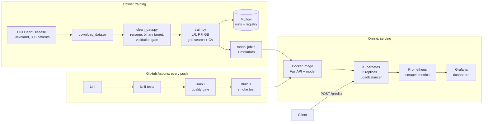

# Heart Disease Risk Prediction — End-to-End MLOps Pipeline

Machine Learning Operations (AIMLCZG523) · Assignment 01 · Vamshi Varma Nampally (2025AE05667)

A classifier that predicts the risk of heart disease from 13 routine clinical measurements, run the way a production service would be run: reproducible training, tracked experiments, automated testing, a containerised API, deployment on Kubernetes and live monitoring.

| Item | Result |
|---|---|
| Final model | Logistic Regression in a scikit-learn pipeline, decision threshold 0.2285 |
| Cross-validation (training data) | F2 0.834, ROC-AUC 0.908, accuracy 0.859 |
| Held-out test set (61 patients) | Recall 1.000, ROC-AUC 0.958, accuracy 0.787, precision 0.683 |
| Testing | 24 pytest unit tests, all passing |
| CI/CD | GitHub Actions: lint → test → train (quality gate) → build and smoke-test container |
| Deployment | FastAPI in Docker, 2 replicas on Minikube behind a LoadBalancer |
| Monitoring | Prometheus scraping each pod every 5 s, Grafana dashboard |


## Architecture



**Offline**, raw data is downloaded, cleaned and validated, then three models are tuned and compared; every run is recorded in MLflow and the winning pipeline is saved with its metadata. **Online**, the saved pipeline is served by a FastAPI application, packaged as a Docker image, deployed on Kubernetes and watched by Prometheus and Grafana. **GitHub Actions** connects the two: every push re-runs linting, tests, training and a container smoke test.

| Layer | Tool | Location |
|---|---|---|
| Data | UCI download and validation | `src/download_data.py`, `src/clean_data.py` |
| Features and model | scikit-learn Pipeline | `src/features.py`, `src/train.py` |
| Experiment tracking | MLflow (SQLite backend) | created locally by `src/train.py` |
| Serving | FastAPI + Uvicorn | `api/main.py` |
| Container | Docker (`python:3.14-slim`, non-root user) | `Dockerfile` |
| Orchestration | Kubernetes on Minikube | `k8s/` |
| Monitoring | Prometheus + Grafana | `monitoring/` |
| CI/CD | GitHub Actions | `.github/workflows/ci.yml` |
| Tests | pytest | `test/` |

## Setup

Everything runs in **GitHub Codespaces** (Ubuntu 24.04, Python 3.14), so the only local requirement is a browser.

### 1. Train and test

```bash
git clone https://github.com/Vamshi1210/heart-disease-mlops.git
cd heart-disease-mlops
python -m venv .venv && source .venv/bin/activate
pip install -r requirements.txt
python src/download_data.py      # data/raw/heart_disease_raw.csv
python src/clean_data.py         # data/processed/heart_disease_clean.csv
python src/train.py              # tunes 3 models, logs to MLflow, saves models/model.joblib
pytest -v                        # 24 tests
```

View experiments in the MLflow UI:

```bash
mlflow ui --backend-store-uri sqlite:///mlflow.db
```

### 2. Run the API in Docker

```bash
docker build -t heart-disease-api:1.1 .
docker run -d -p 8000:8000 heart-disease-api:1.1
curl -X POST localhost:8000/predict -H "Content-Type: application/json" \
     -d @api/sample_request.json
```

Interactive API documentation: `http://localhost:8000/docs`

### 3. Deploy on Kubernetes

```bash
minikube start
minikube image load heart-disease-api:1.1
kubectl apply -f k8s/
minikube tunnel                        # separate terminal; gives the LoadBalancer an IP
kubectl get svc heart-api -n mlops     # EXTERNAL-IP is the API address
```

### 4. Monitoring

```bash
kubectl apply -k monitoring/
kubectl port-forward svc/prometheus 9090:9090 -n mlops
kubectl port-forward svc/grafana 3000:3000 -n mlops
python monitoring/send_traffic.py http://<EXTERNAL-IP> 300   # API address, number of requests
```

Prometheus: `http://localhost:9090` · Grafana: `http://localhost:3000`

**Access.** Deployment is local (Minikube), so there is no public URL. The API is reached at the LoadBalancer IP shown by `kubectl get svc` while `minikube tunnel` runs, or through `kubectl port-forward`.

## API

| Endpoint | Purpose |
|---|---|
| `GET /health` | Service status, model version and model type |
| `POST /predict` | Patient data as JSON → prediction, label, disease probability, confidence, threshold, model version |
| `GET /metrics` | Prometheus metrics |
| `GET /docs` | Swagger documentation |

Example response for `api/sample_request.json`:

```json
{
  "prediction": 0,
  "label": "heart disease unlikely",
  "disease_probability": 0.2001,
  "confidence": 0.7999,
  "decision_threshold": 0.2285,
  "model_version": "2026.10.16-1035"
}
```

Invalid input (for example `"age": -5`) is rejected with HTTP 422 before it reaches the model.

## Model

- **Data:** UCI Heart Disease, Cleveland subset (303 patients, 13 features). The 1,025-row Kaggle `heart.csv` was avoided because it repeats the same ~300 patients, which leaks rows between train and test.
- **Models compared:** Logistic Regression, Random Forest, Gradient Boosting, each tuned with grid search and stratified k-fold cross-validation on an 80/20 stratified split; every combination logged as a nested MLflow run.
- **Selection metric:** F2 (recall weighted twice as heavily as precision), because a missed diagnosis costs more than a false alarm.
- **Decision threshold:** tuned for F2 with cross-validation on the training data only (0.2285), and stored inside the saved model so the API applies the same rule.

| Model | Accuracy | Precision | Recall | F2 | ROC-AUC |
|---|---|---|---|---|---|
| **Logistic Regression** | **0.859** | **0.870** | **0.828** | **0.834** | **0.908** |
| Random Forest | 0.826 | 0.833 | 0.783 | 0.790 | 0.898 |
| Gradient Boosting | 0.802 | 0.779 | 0.793 | 0.789 | 0.853 |

On the 61-patient test set the model caught all 28 patients with heart disease, at the cost of 13 false alarms among 33 healthy patients.

## CI/CD

`.github/workflows/ci.yml` runs on every push; each job starts only if the previous one passed:

1. **Lint** — flake8
2. **Unit tests** — pytest, JUnit report saved as an artifact
3. **Train** — data validation, training with MLflow, quality gate (fails if metrics drop below a set minimum)
4. **Build and smoke-test** — builds the Docker image with the new model and calls `/health` and `/predict`

Artifacts per run: `test-report`, `mlflow-run`, `trained-model`.

## Repository structure

```
heart-disease-mlops/
├── .github/workflows/ci.yml   CI pipeline
├── api/                       FastAPI service, serving requirements, sample request
├── data/                      Raw and cleaned dataset
├── k8s/                       Namespace, Deployment, Service manifests
├── models/                    Final model and metadata
├── monitoring/                Prometheus, Grafana, traffic generator
├── notebooks/01_eda.ipynb     Exploratory data analysis
├── screenshots/               Evidence screenshots
├── src/                       Download, cleaning, features, training
├── test/                      24 unit tests
├── Dockerfile
├── requirements.txt
└── README.md
```
