**Code repository:** <https://github.com/Vamshi1210/heart-disease-mlops>

**Video walkthrough:** 

# 1. Introduction

Heart disease screening is a setting where the two kinds of error do not cost the same. A sick patient who is told they are healthy may go untreated, while a false alarm usually leads only to a follow-up test. This project builds a classifier that predicts the risk of heart disease from 13 routine clinical measurements, and runs it the way a production service would be run: reproducible training, tracked experiments, automated testing, a containerised API, deployment on Kubernetes, and live monitoring.

| Item | Result |
|---|---|
| Final model | Logistic Regression in a scikit-learn pipeline, decision threshold 0.2285 |
| Cross-validation (training data) | F2 0.834, ROC-AUC 0.908, accuracy 0.859 |
| Held-out test set (61 patients) | Recall 1.000, ROC-AUC 0.958, accuracy 0.787, precision 0.683 |
| Testing | 24 pytest unit tests, all passing |
| CI/CD | GitHub Actions: lint → test → train (quality gate) → build and smoke-test container, about 4 minutes |
| Deployment | FastAPI in Docker, 2 replicas on Minikube behind a LoadBalancer |
| Monitoring | Prometheus scraping each pod every 5 s, Grafana dashboard |

# 2. Architecture

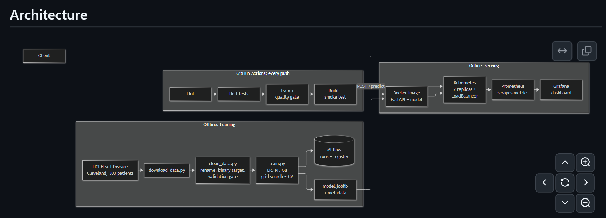

The system has an offline half and an online half. **Offline**, raw data is downloaded, cleaned and validated, then three models are tuned and compared; every run is recorded in MLflow and the winning pipeline is saved with its metadata. **Online**, the saved pipeline is served by a FastAPI application, packaged as a Docker image, deployed on Kubernetes and watched by Prometheus and Grafana. **GitHub Actions** connects the two: every push re-runs linting, tests, training and a container smoke test, so nothing broken reaches the image.

| Layer | Tool | Location in repository |
|---|---|---|
| Data | UCI download and validation | `src/download_data.py`, `src/clean_data.py` |
| Features and model | scikit-learn Pipeline | `src/features.py`, `src/train.py` |
| Experiment tracking | MLflow 3.17.1 (SQLite backend) | `mlflow.db`, `mlruns/` |
| Serving | FastAPI + Uvicorn | `api/main.py` |
| Container | Docker (`python:3.14-slim`, non-root user) | `Dockerfile` |
| Orchestration | Kubernetes on Minikube | `k8s/` |
| Monitoring | Prometheus + Grafana | `monitoring/` |
| CI/CD | GitHub Actions | `.github/workflows/ci.yml` |
| Tests | pytest | `test/` |

# 3. Setup and Access Instructions

Development and deployment run in **GitHub Codespaces** (Ubuntu 24.04, Python 3.14), so the only local requirement is a browser. The README contains the complete step-by-step commands; the essentials are:

**Train and test**

```bash
git clone https://github.com/Vamshi1210/heart-disease-mlops.git
cd heart-disease-mlops
python -m venv .venv && source .venv/bin/activate
pip install -r requirements.txt
python src/download_data.py
python src/clean_data.py
python src/train.py
pytest -v
```

**Run the API in Docker**

```bash
docker build -t heart-disease-api:1.1 .
docker run -d -p 8000:8000 heart-disease-api:1.1
curl -X POST localhost:8000/predict -H "Content-Type: application/json" \
     -d @api/sample_request.json
```

**Deploy on Kubernetes and monitor**

```bash
minikube start
minikube image load heart-disease-api:1.1
kubectl apply -f k8s/
minikube tunnel                        # separate terminal; gives the LoadBalancer an IP
kubectl get svc heart-api -n mlops     # EXTERNAL-IP is the API address
kubectl apply -k monitoring/
kubectl port-forward svc/prometheus 9090:9090 -n mlops
kubectl port-forward svc/grafana 3000:3000 -n mlops
```

**Access.** Deployment is local (Minikube), so there is no public URL. The API is reached at the LoadBalancer IP shown by `kubectl get svc` while `minikube tunnel` runs, or through `kubectl port-forward`. Interactive API documentation is served at `/docs`.

# 4. Data Acquisition and Exploratory Data Analysis

## 4.1 Dataset choice

The project uses the **UCI Heart Disease dataset (Cleveland subset)**: 303 patients, 13 clinical features and a diagnosis from 0 to 4. I deliberately avoided the widely shared 1,025-row `heart.csv` found on Kaggle. It mostly repeats the same ~300 patients, so identical rows land in both the training and the test set and inflate accuracy, which is a form of data leakage.

## 4.2 Download, cleaning and validation

- `src/download_data.py` fetches the data from the UCI repository and saves `data/raw/heart_disease_raw.csv` (303 rows × 14 columns).
- `src/clean_data.py` renames the cryptic UCI codes to readable names (for example `cp` → `chest_pain_type`, `ca` → `num_major_vessels`, `thal` → `thalassemia`), converts the diagnosis into a **binary target** (0 = no disease, 1–4 = disease) and drops the original column, and removes duplicate rows (none were found).
- A **validation gate** rejects physically impossible values, such as an age of 500, a cholesterol of 5 or an unknown category code. Bad data stops the pipeline before training instead of silently producing a bad model.
- **Missing values** (4 in `num_major_vessels`, 2 in `thalassemia`) are kept rather than dropped. They are imputed inside the model pipeline, so exactly the same rule applies at prediction time, and the API can still score a patient whose results for these tests are unknown.
- The cleaned file is saved as `data/processed/heart_disease_clean.csv`, and an **MD5 fingerprint** of it is recorded with every model as its data version.

## 4.3 Exploratory analysis

The analysis lives in `notebooks/01_eda.ipynb`. The classes are roughly balanced (164 without disease, 54%; 139 with disease, 46%), so no resampling was needed, although class weighting was still tried during tuning.

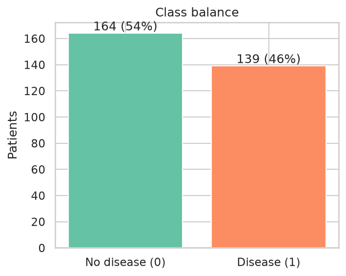

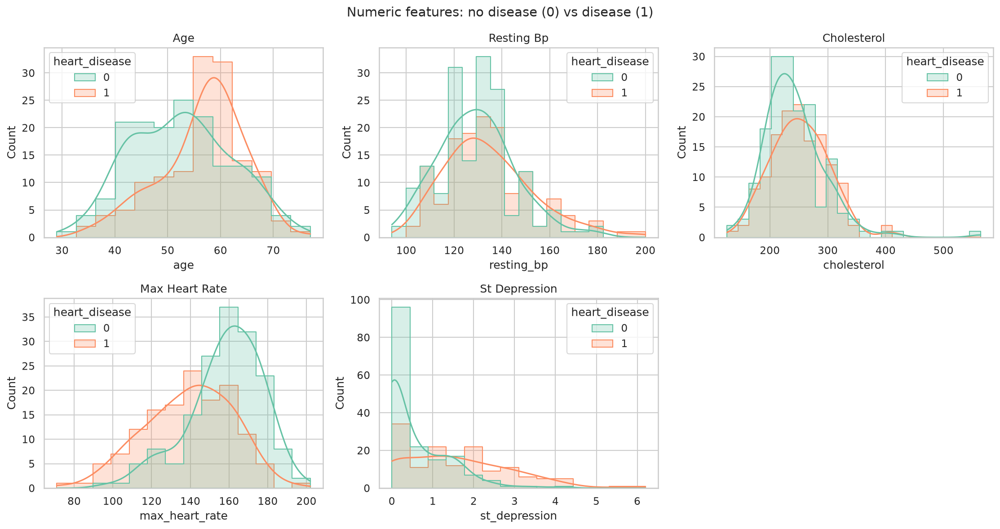

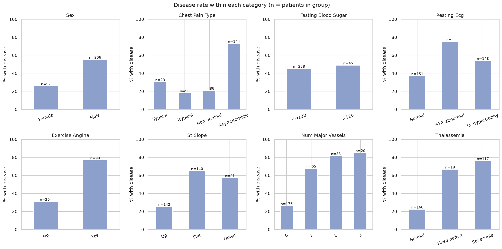

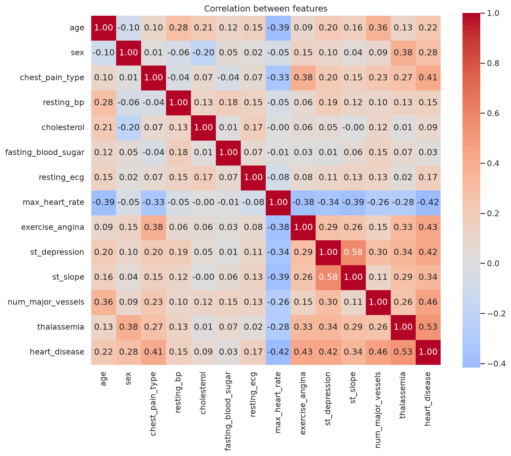

**Key findings.** The features most strongly related to the target are **thalassemia**, **number of major vessels** and **exercise-induced angina**.

- Chest pain type gave the most surprising result. Patients with asymptomatic chest pain (type 4) had the highest disease rate, higher even than patients with typical angina. So “more pain means more risk” does not hold here. This is also why I one-hot encoded chest pain type instead of treating it as a number.
- How the heart reacts to exercise is one of the strongest signals. Patients with disease had a clearly lower maximum heart rate and higher ST depression, and exercise-induced angina was much more common among them. Cholesterol, which I expected to matter a lot, showed only a weak link to the target.

# 5. Feature Engineering and Model Development

## 5.1 Features and preprocessing

The 13 inputs are grouped into numeric, binary and nominal features (`src/features.py`). Preprocessing is part of the model pipeline itself: missing values are imputed, numeric features are scaled, and nominal codes such as chest pain type and thalassemia are **one-hot encoded**, because their values are labels rather than quantities. Codes never seen during training are ignored instead of crashing the service. Each of these behaviours is covered by a unit test.

## 5.2 Models, tuning and selection

Three models were trained on a stratified 80/20 split (242 training, 61 test patients): **Logistic Regression**, **Random Forest** and **Gradient Boosting**. Each was tuned with a grid search using stratified k-fold cross-validation on the training data, and every hyperparameter combination was logged as a nested MLflow run.

The selection metric is **F2**, which weights recall twice as heavily as precision, because a missed diagnosis is costlier than a false alarm. Cross-validated results for the best configuration of each model:

| Model | Accuracy | Precision | Recall | F2 (± std) | ROC-AUC |
|---|---|---|---|---|---|
| **Logistic Regression** | **0.859** | **0.870** | **0.828** | **0.834 ± 0.037** | **0.908** |
| Random Forest | 0.826 | 0.833 | 0.783 | 0.790 ± 0.071 | 0.898 |
| Gradient Boosting | 0.802 | 0.779 | 0.793 | 0.789 ± 0.049 | 0.853 |

Logistic Regression won on every metric and was also the most stable across folds (lowest standard deviation). On a dataset of this size, a simple, interpretable model generalising better than tree ensembles is a reasonable outcome. Its best parameters were `C = 1` and `class_weight = balanced`.

## 5.3 Decision threshold

A classifier normally predicts "disease" when the probability exceeds 0.5. For screening that is too conservative, so the threshold was tuned to maximise F2, giving **0.2285**. The threshold is stored inside the saved model and in its metadata, so the API applies exactly the same rule.

## 5.4 Test-set results

| Metric | Test set (61 patients) |
|---|---|
| Recall | **1.000** |
| ROC-AUC | **0.958** |
| F2 | 0.915 |
| Accuracy | 0.787 |
| Precision | 0.683 |

The model caught **all 28 patients with heart disease** in the test set, at the cost of **13 false alarms** among the 33 healthy patients. Test precision is lower than in cross-validation precisely because the threshold was lowered on purpose: this is the trade-off chosen for screening.

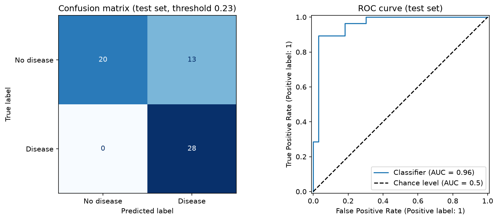

# 6. Experiment Tracking (MLflow)

MLflow 3.17.1 uses a SQLite backend (`mlflow.db`) with artifacts stored in `mlruns/`, all under the experiment **heart-disease-classifier**. Runs are organised as one parent run per model family, nested child runs for each hyperparameter combination, and a final run for the selected model; across all training sessions the experiment holds 28 runs. Parameters, metrics (cross-validation means and standard deviations, and test metrics) and artifacts (evaluation plots and the model itself) are logged.

The final model is **registered in the Model Registry** as "mlops model" version 1, and MLflow records its lineage: the script (`train.py`), the branch (`main`) and the exact git commit (`acf680f`). One failed Gradient Boosting run is still visible; it is the attempt made before the serialisation fix described in Section 12, kept as part of the history.

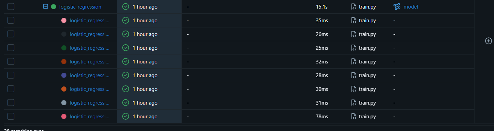

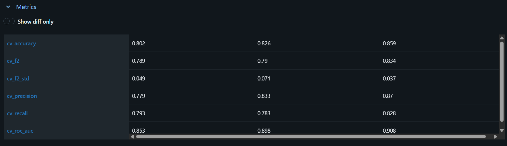

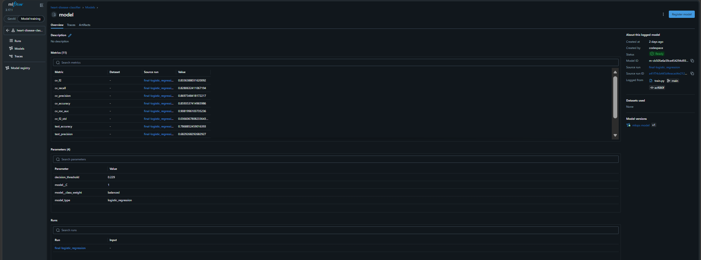

# 7. Model Packaging and Reproducibility

- **One pipeline, one file.** Preprocessing, classifier and threshold are saved together as `models/model.joblib`, so serving can never drift from the preprocessing used in training.
- **Metadata.** `models/model_metadata.json` records the model version, model type, decision threshold, feature list, best parameters, cross-validation and test metrics, data version, MLflow run ID and scikit-learn version.
- **MLflow model package.** The logged model contains `MLmodel`, `model.pkl`, `conda.yaml`, `python_env.yaml` and `requirements.txt`, and loads either as a plain scikit-learn model or through MLflow's generic `python_function` interface.
- **Dependencies.** `requirements.txt` covers training and development; `api/requirements.txt` holds only the slim serving dependencies used by the Docker image; `requirements.lock` pins exact versions (MLflow 3.17.1, scikit-learn 1.9.1, pandas 3.0.6, NumPy 2.5.4).
- **Proof of reproducibility.** CI retrains the model from a clean environment on every push and reproduces the same decision threshold (0.2285) and the same test metrics. Model version labels differ between runs only because they are training timestamps.

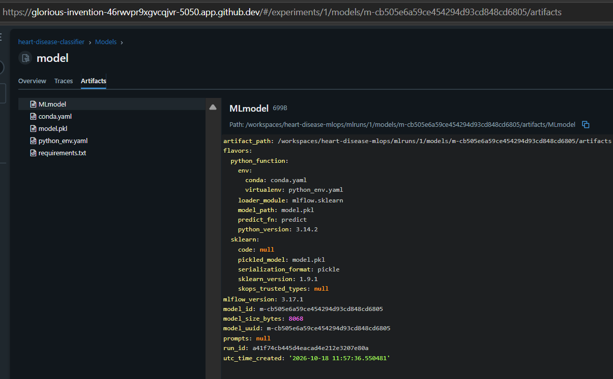

# 8. CI/CD Pipeline and Automated Testing

## 8.1 Unit tests

| Test file | Tests | What is checked |
|---|---|---|
| `test_clean_data.py` | 8 | Column renaming, duplicate removal, binary target, validation accepts missing values and rejects impossible ones |
| `test_model.py` | 6 | Complete feature list without the target, imputation, one-hot encoding, unseen codes, metric calculation, a lower threshold raising recall |
| `test_api.py` | 10 | `/health`, prediction with confidence, missing optional fields, five kinds of invalid input, a missing required field, `/metrics` counters |

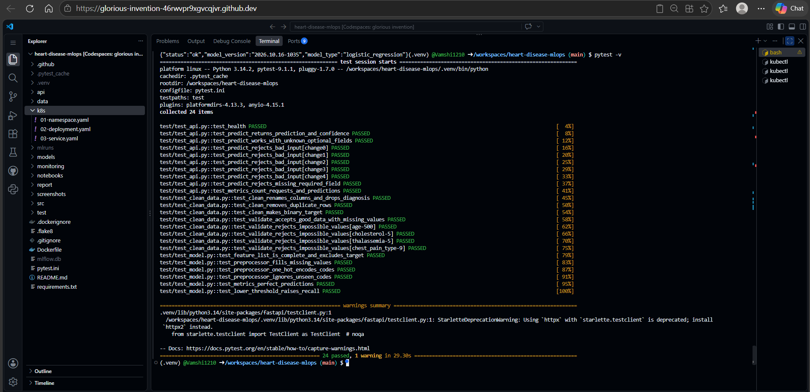

## 8.2 Workflow

Every push runs `.github/workflows/ci.yml` on a pinned `ubuntu-24.04` runner. Each job starts only if the previous one succeeded:

| Job | What it does | Duration |
|---|---|---|
| 1. Lint | flake8 code-style check | 8 s |
| 2. Unit tests | pytest, JUnit report saved as an artifact | 1 m 9 s |
| 3. Train | Data validation, training with MLflow, **quality gate** (fails if the model's metrics drop below a set minimum), metrics table in the run summary | 1 m 49 s |
| 4. Build and smoke-test | Builds the Docker image with the newly trained model and calls `/health` and `/predict` | 41 s |

Each run publishes three artifacts: `test-report`, `mlflow-run` and `trained-model`.

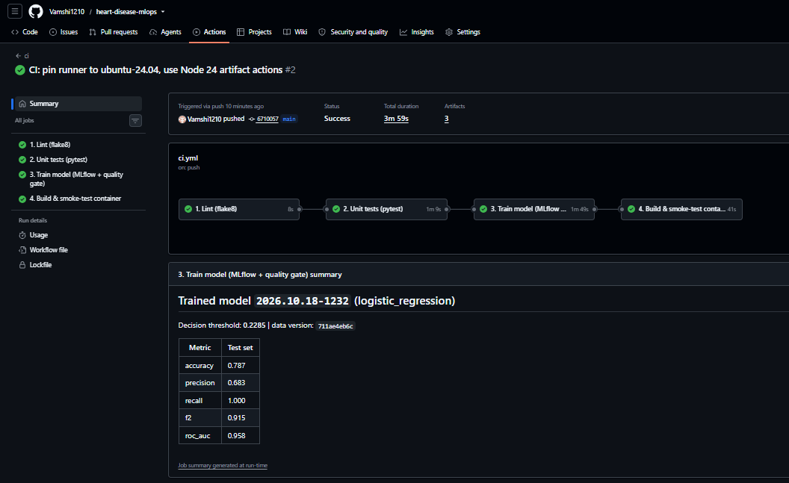

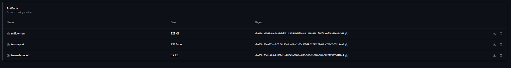

## 8.3 Failure demonstration

To prove that the pipeline stops on bad code, a deliberate style error was pushed on a separate branch (`ci-failure-demo`). The lint job failed with a clear message naming the file, line and rule, and all later jobs were skipped, so the broken code never reached the container image.

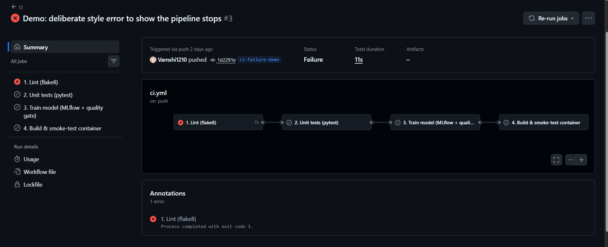

# 9. Model Containerisation

The `Dockerfile` starts from `python:3.14-slim`, installs only the serving dependencies, copies in the API code and the model, runs as a **non-root user** and defines a **health check**, so Docker itself reports whether the service is ready.

| Endpoint | Purpose |
|---|---|
| `GET /health` | Service status, model version and model type |
| `POST /predict` | Accepts patient data as JSON and returns prediction, label, disease probability, confidence, threshold and model version |
| `GET /metrics` | Prometheus metrics |
| `GET /docs` | Interactive Swagger documentation |

Example response for the sample patient in `api/sample_request.json`:

```json
{
  "prediction": 0,
  "label": "heart disease unlikely",
  "disease_probability": 0.2001,
  "confidence": 0.7999,
  "decision_threshold": 0.2285,
  "model_version": "2026.10.16-1035"
}
```

Inputs are validated: an impossible value such as `age: -5` is rejected with HTTP 422 and a clear message before it reaches the model.

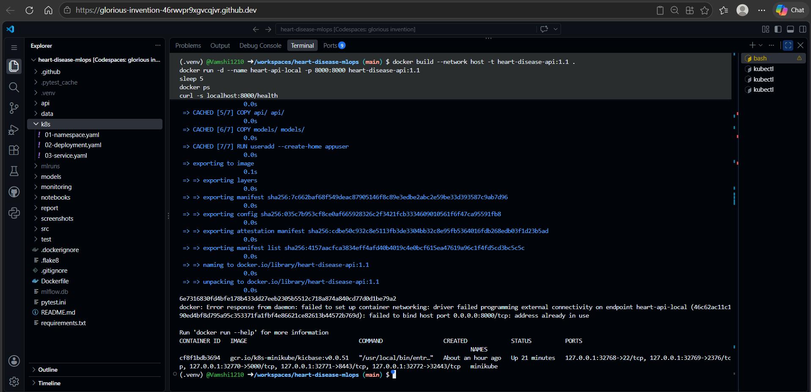

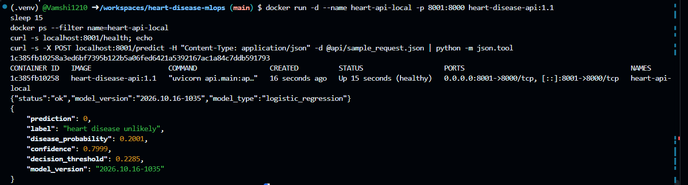

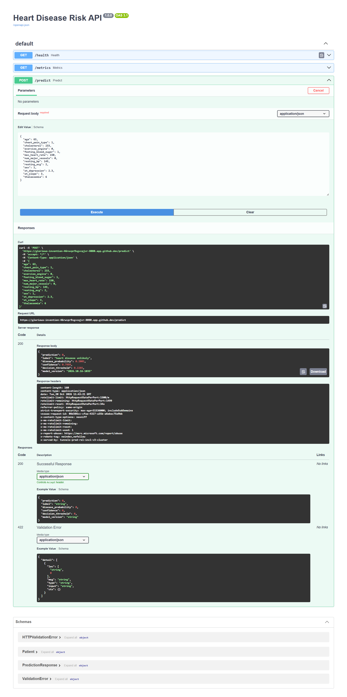

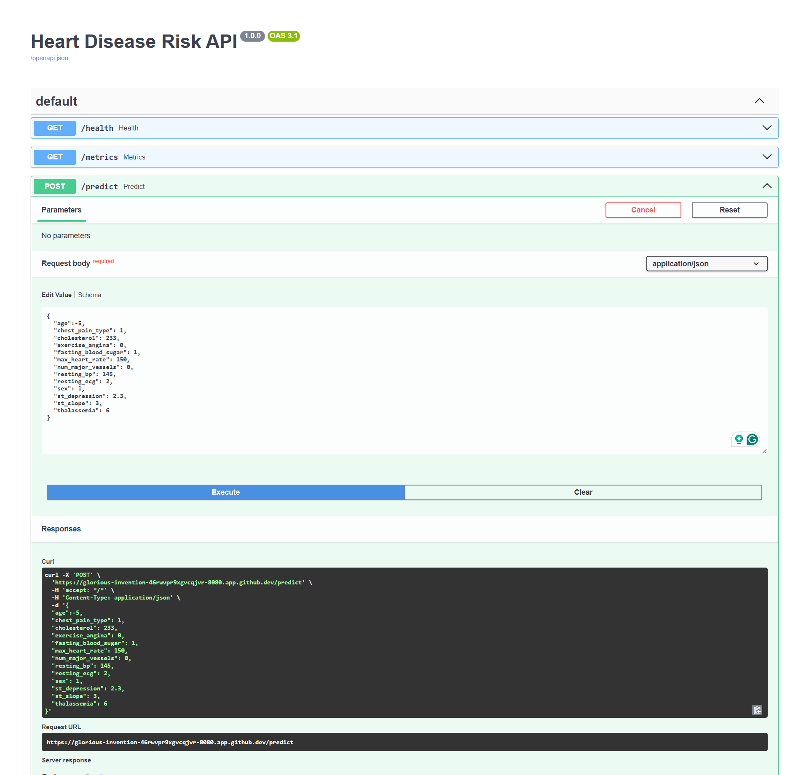

# 10. Production Deployment (Kubernetes)

The API runs on **Minikube** inside the Codespace. The manifests in `k8s/` create:

- a namespace, `mlops`
- a **Deployment** with **2 replicas**, readiness and liveness probes, and resource limits
- a **LoadBalancer Service** mapping port 80 to the container's port 8000, plus a headless service that lets Prometheus reach each pod individually

Because the Codespace cannot pull images from inside the cluster, images are loaded with `minikube image load`. With `minikube tunnel` running, the LoadBalancer received the external IP 10.110.85.139, and `/health` and `/predict` were verified through it, returning the same prediction as the local container.

**Self-healing.** When a pod was deleted, the Deployment immediately created a replacement. It received traffic only after passing its readiness probe (0/1 → 1/1), while the second replica kept serving.

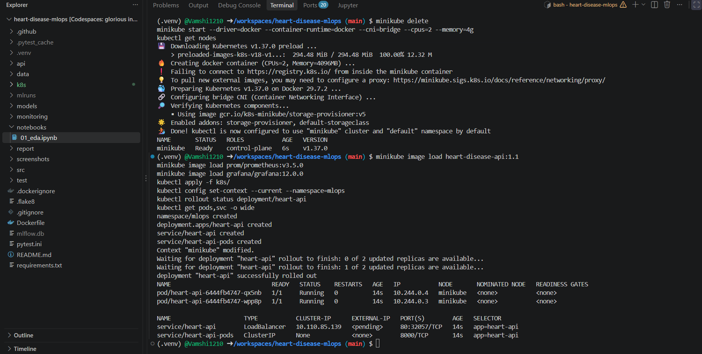

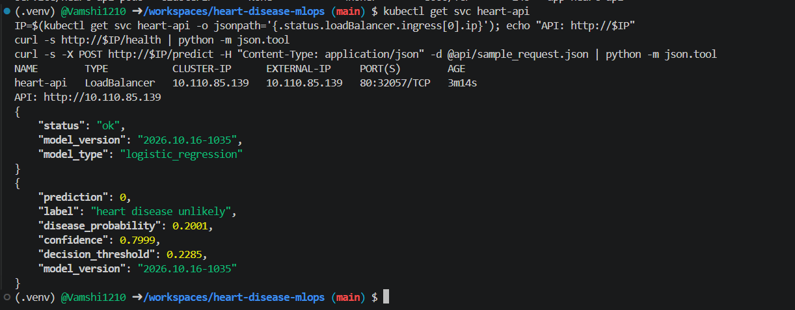

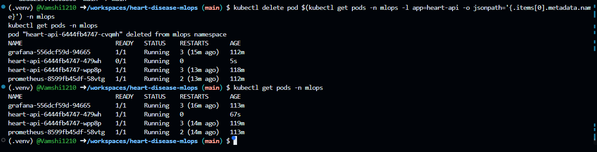

# 11. Monitoring and Logging

- **Logging.** Every API request is logged with its outcome. Patient measurements are never written to the logs.
- **Metrics.** `/metrics` exposes request counts, latency histograms, predictions by result and the distribution of predicted risk.
- **Prometheus** scrapes each pod every 5 seconds.
- **Grafana** opens an automatically provisioned dashboard with 8 panels: pods up, request rate, p50/p95 latency, predictions per result, invalid requests, and average predicted risk as a simple drift signal.
- **Load test.** `monitoring/send_traffic.py` generates realistic traffic. In the Prometheus graph below, the two load tests peak at about 4.8 requests per second, over a baseline of background traffic from health checks and monitoring.

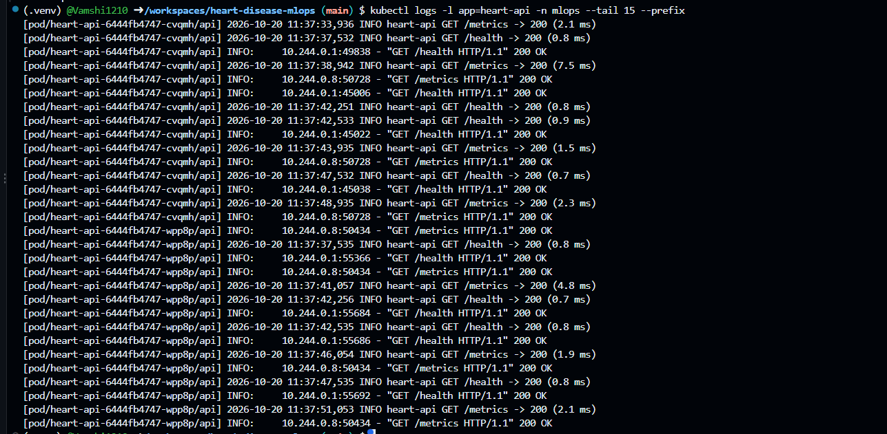

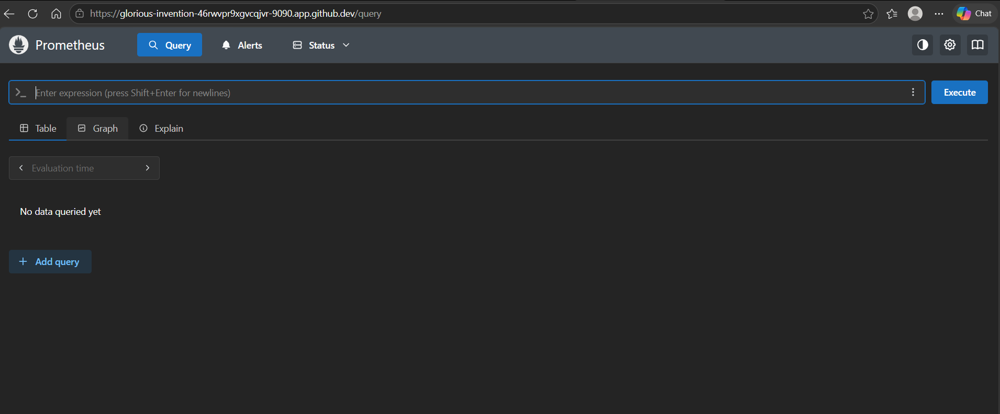

![Figure 24: Request rate in Prometheus, sum(rate(http_requests_total[1m]))](../screenshots/task_prometheus_every_graph.png)

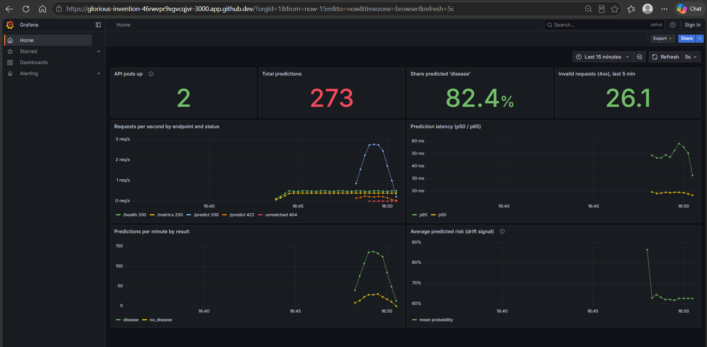

# 12. Challenges and Solutions

| Problem | Cause | Solution |
|---|---|---|
| MLflow failed to save the model | Incompatibility with MLflow's default `skops` serialisation | Switched to the `pickle` format |
| Docker builds timed out | Network restrictions inside Codespaces | Built with `--network host` |
| Kubernetes node stayed NotReady | Minikube's default network add-on could not be downloaded | Diagnosed with `kubectl get nodes` and events, switched to the built-in bridge network |
| Pods could not pull images | No registry access from inside the cluster | Loaded images directly with `minikube image load` |
| EDA notebook became empty | File lost between editor sessions | Rebuilt and committed it; adopted the habit of pushing at the end of every session |
| Port 8000 already in use | An earlier process still held the port | Ran the container on port 8001 |

# 13. Conclusion and Future Work

The project delivers a complete, reproducible path from raw data to a monitored service: validated data, three tuned models compared in MLflow, a recall-focused Logistic Regression pipeline, 24 automated tests, a four-stage CI pipeline with a quality gate, a hardened Docker image, a self-healing Kubernetes deployment and a live monitoring dashboard.

**Future work:** push the image to a container registry and deploy automatically to a managed cluster (GKE or EKS); add Prometheus alerting on error rate and latency; replace the simple drift signal with statistical drift tests on input distributions; promote models through registry stages; and extend training to the other UCI sites (Hungary, Switzerland, VA) to test how well the model generalises.

**What I learned:** Training the model was the smallest part of this project. Most of the effort went into making it repeatable and safe: validating the data, tracking every run, writing tests, and making the pipeline stop on bad code. I also learned that the “best” model depends on the cost of mistakes. I chose a threshold that catches every sick patient, even though it adds some false alarms.

# Appendix A: Repository Structure

```
heart-disease-mlops/
├── .github/workflows/ci.yml   CI pipeline
├── api/                       FastAPI service, serving requirements, sample request
├── data/raw/, data/processed/ Raw and cleaned dataset
├── k8s/                       Namespace, Deployment, Service manifests
├── models/                    Final model and metadata
├── monitoring/                Prometheus, Grafana, traffic generator
├── notebooks/01_eda.ipynb     Exploratory data analysis
├── report/                    This report and its figures
├── screenshots/               Evidence screenshots
├── src/                       Download, cleaning, features, training
├── test/                      24 unit tests
├── Dockerfile
├── requirements.txt, requirements.lock
└── README.md                  Setup and access instructions
```
